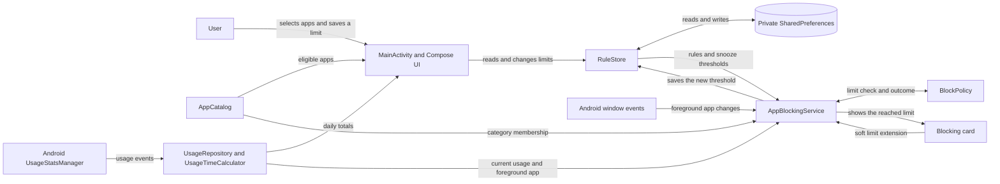

# ScreenOfficer M2 architecture

ScreenOfficer uses Android usage events to show daily activity and interrupt apps that reach a saved limit. The core flow runs on-device.

## Follow a limit through the app

1. The Compose screens keep navigation, app selection and draft fields in `rememberSaveable`. **Save limit** validates the draft and writes the rule through `RuleStore`. Private `SharedPreferences` hold saved rules and soft-block snooze thresholds.
2. `UsageRepository` reads Android usage events and the blocking card intervals recorded locally by `AppBlockingService`. `UsageTimeCalculator` excludes those intervals from the covered app's foreground usage. **Today** shows usage against saved limits, and **History** reads per-app totals for each local day from the events Android still has.
3. `AppBlockingService` checks the foreground app against enabled rules and current usage. For a shared limit, it adds the selected apps' time. `BlockPolicy` checks the threshold and gives a reached hard limit priority over a soft one. The service shows the card. A soft block can save an extra five minutes of measured use.

## Permission fallback

When Usage Access is off, ScreenOfficer shows an unavailable state and a route to Android Settings. Enforcement waits for usable data, and the app picker may be empty because it uses recent activity. With Usage Access enabled and the accessibility service off, the user can still manage saved rules and view usage. Re-enabling the service restores blocking.

[Compose UI](../app/src/main/java/com/example/screenofficer/MainActivity.kt) · [RuleStore](../app/src/main/java/com/example/screenofficer/RuleStore.kt) · [UsageRepository](../app/src/main/java/com/example/screenofficer/UsageRepository.kt) · [UsageTimeCalculator](../app/src/main/java/com/example/screenofficer/UsageTimeCalculator.kt) · [Blocking service](../app/src/main/java/com/example/screenofficer/AppBlockingService.kt) · [Rules and block policy](../app/src/main/java/com/example/screenofficer/AppRule.kt)
